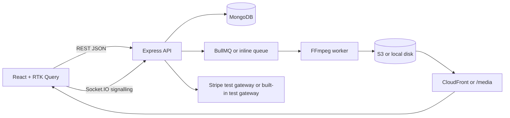

# Homeroom

Homeroom is a complete MERN online-school application: course catalogue, paid and free enrolment, video lessons, quizzes, certificates, instructor earnings, an admin area and browser-to-browser live classes.


## Problem statement

An online course platform normally requires several disconnected tools: a catalog and checkout, a video host, a quiz engine, a live classroom and a certificate issuer. Homeroom combines these into one application with three roles, a single codebase and a zero-account local mode, while keeping production integrations behind configuration rather than source changes.

## Submission status

- Source is complete and locally verified.
- Automated suite: **49/49 passing**. Production build: **passing**.
- Browser QA: Phases A–G completed; see [docs/TEST_RESULTS.md](docs/TEST_RESULTS.md).
- GitHub: source and documentation are published at <https://github.com/sanskarp10/homeroom-lms>.
- Deployment: none. Local fallbacks are active. See [docs/DEPLOYMENT.md](docs/DEPLOYMENT.md).

## Quick start

Requires Node.js 20+.

```bash
npm install
npm run dev
```

Open <http://localhost:5173>. The API runs on <http://localhost:4000>. On first start the setup script creates `server/.env` with a random JWT secret; if no MongoDB or Redis is reachable, the app uses an embedded database and an in-process video queue. Demo content is loaded automatically.

Demo accounts (password `homeroom123`; one-click buttons on the sign-in page):

| Role | Email |
| --- | --- |
| Student | `sam@homeroom.test` |
| Instructor | `maya@homeroom.test` |
| Admin | `admin@homeroom.test` |

## Technology stack

- **Frontend:** React 18, Vite, Redux Toolkit + RTK Query, React Router, Tailwind CSS, hls.js, Socket.IO client.
- **Backend:** Node.js, Express, Mongoose/MongoDB, Zod validation, JWT + bcrypt, Helmet, rate limiting, Socket.IO.
- **Media:** FFmpeg with adaptive HLS (360p/720p/1080p, never upscaled). BullMQ/Redis in production, inline queue locally.
- **Storage:** S3 + CloudFront in production, local `/media` disk in development.
- **Payments:** Stripe Checkout test mode in production, built-in test gateway locally.
- **Live classes:** WebRTC mesh with STUN; optional TURN.

## System architecture



One Node process serves the API, WebSockets and, in production, the built React app. The worker runs in that process by default and can be split out with `npm run worker`. External drivers are selected in `server/src/config.js`; untouched `REPLACE_ME` values mean "not configured" and activate a local fallback.

See [docs/ARCHITECTURE.md](docs/ARCHITECTURE.md) for the full diagrams, data model and design decisions.

## Roles

| Role | What they can do |
| --- | --- |
| Student | Browse and buy courses, watch video, complete quizzes, track progress, join live classes, download certificates. |
| Instructor | Create and publish courses, upload video, build quizzes, schedule live classes, view earnings and students. |
| Admin | Platform totals, people and role management, course moderation, video pipeline and queue state. |

Role checks are enforced on every protected REST route and Socket.IO handshake; course ownership is checked separately from role.

## Feature map

| Brief area | Implementation |
| --- | --- |
| Roles and schema | Mongoose models in `server/src/models`; guarded routes in `server/src/routes`. |
| Course creation and uploads | Course editor with sections, video/reading/quiz lessons, reordering and publish checklist. FFmpeg produces HLS and a poster. |
| Media delivery | Private S3 + CloudFront in production; identical code path serves local disk in development. |
| Quizzes and progress | Server-side grading, explanations, retakes, playback resume, 90% completion rule. |
| Live classes | WebRTC mesh, waiting room, chat, raise hand, host mute-all, screen share, timetable. |
| Certificates | PDFKit PDF generated on completion, public ID verification page. |
| Payments and earnings | Stripe test Checkout with webhook, or built-in test gateway; 80/20 order split and dashboards. |

## Installation and execution

| Command | Purpose |
| --- | --- |
| `npm run dev` | API + Vite with reload |
| `npm run build` / `npm start` | Production build and single-server run on port 4000 |
| `npm test` | Vitest + Supertest suite against isolated test DB and real FFmpeg |
| `npm run doctor` | Dependency and configuration check |
| `npm run seed:reset` | Reload demo content (destructive; not used during QA) |
| `npm run worker` | Standalone video worker |
| `npm run create-admin -- email password "Name"` | Create or promote an admin |

## Environment configuration

All server settings live in `server/.env`, copied from [`server/.env.example`](server/.env.example). `client/.env` is only needed for split hosting. The full variable reference and step-by-step production setup are in [`SETUP_GUIDE.md`](SETUP_GUIDE.md).

Never commit `.env` files. Placeholders count as "not set" and select local fallbacks.

## API structure

REST endpoints are grouped under `/api/auth`, `/api/courses`, `/api/manage`, `/api/learn`, `/api/payments`, `/api/instructor`, `/api/live`, `/api/certificates` and `/api/admin`. Authenticated requests use `Authorization: Bearer <token>`. Socket.IO connects with `auth: { token }` and emits `live:join`, `live:signal`, `live:state`, `live:chat`, `live:mute-all`, `live:lower-hand` and `live:leave`. Full details: [docs/API.md](docs/API.md).

## Database design

Core collections: `users`, `courses` (embedded sections), `lessons`, `enrollments`, `quizattempts`, `orders`, `liveclasses`, `livemessages` and `certificates`. Money is stored in integer cents; certificates snapshot names and titles. See [docs/ARCHITECTURE.md](docs/ARCHITECTURE.md).

## Video processing and streaming

Upload returns immediately; the worker probes the source, produces renditions at or below the source height and a poster, then writes status and progress to the lesson document. Keys are stored, not URLs, so the delivery domain can change without migration. The editor polls only while conversion is active.

## WebRTC live classes

The server authenticates sockets, checks enrollment and relays signalling, presence, chat and host actions; media never passes through it. The participant who joins later offers. Camera/screen changes use `replaceTrack()`, and Socket.IO reconnects rejoin the room. Mesh topology is comfortable up to about eight cameras; larger classes need an SFU.

## Payments

With `STRIPE_SECRET_KEY` set, buyers go to Stripe Checkout test mode and fulfilment is confirmed by both the success page and webhook. Without it, a clearly labelled built-in test gateway accepts Stripe's test card numbers. Every paid order stores gross amount, platform fee and instructor net; payouts to instructors are not implemented.

## Testing

```bash
npm test          # 49 tests
npm run doctor    # 5 PASS, 5 WARN locally, 0 FAIL
npm run build     # production bundle
```

Browser QA covered authentication (A), student learning (B), instructor workflow (C), admin (D), payments (E), live classes (F) and media reliability (G). Results and evidence: [docs/TEST_RESULTS.md](docs/TEST_RESULTS.md) and [docs/EVIDENCE.md](docs/EVIDENCE.md).

## Deployment

No live deployment exists yet. The recommended academic-submission path and the exact credentials required are documented in [docs/DEPLOYMENT.md](docs/DEPLOYMENT.md). Do not treat local fallbacks as production integrations.

## Known limitations

- Live rooms are held in memory: one API instance unless a Socket.IO Redis adapter is added.
- WebRTC mesh scales to roughly eight cameras; TURN is not configured locally.
- CloudFront URLs are unguessable but unsigned; signed cookies are the next step for paid media.
- JWTs are stored in `localStorage` and have no server-side revocation list; disabling an account takes effect on the next request.
- Instructor earnings are recorded and reported, not paid out.
- Physical camera/microphone and device switching were not verified in headless QA.
