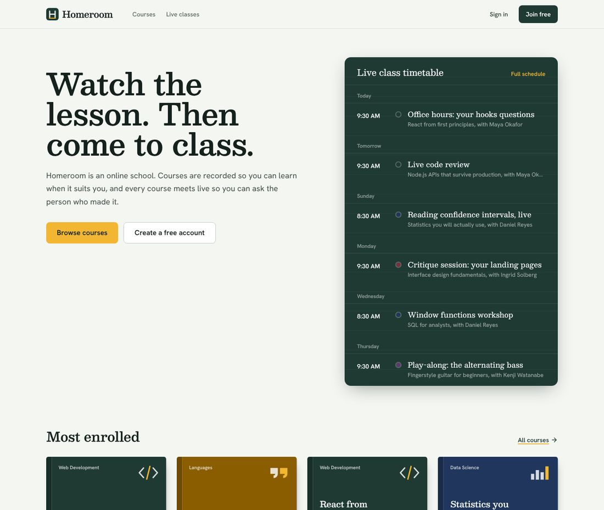
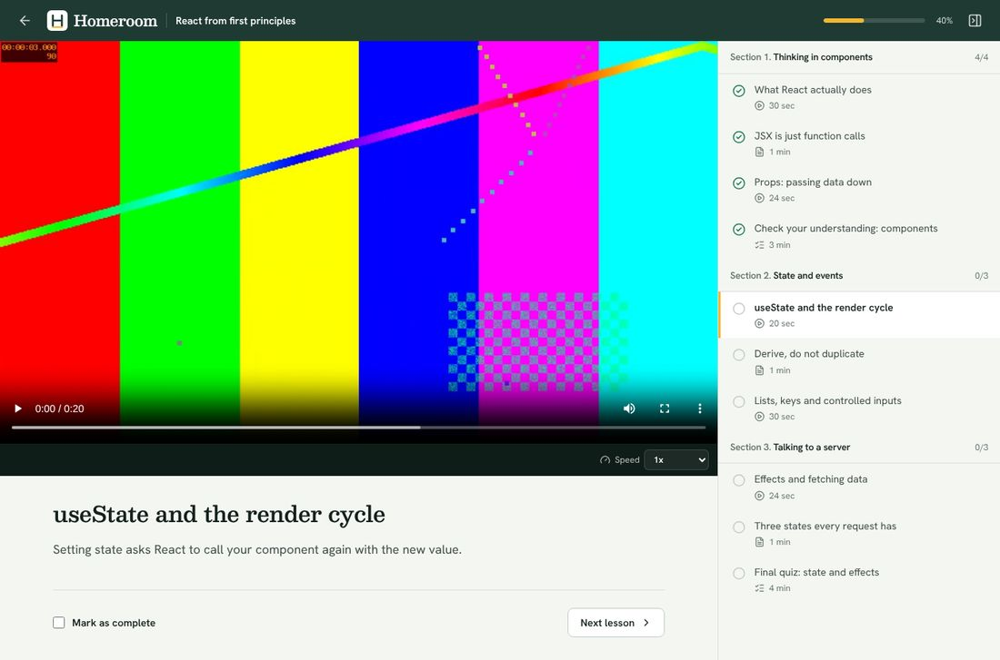
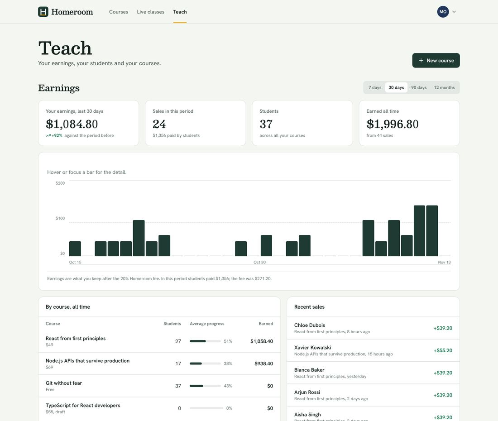
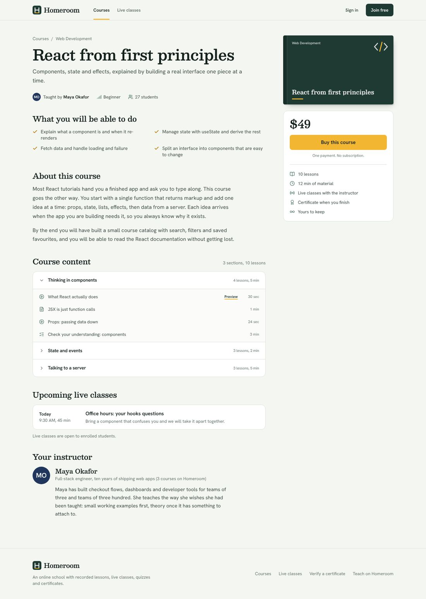
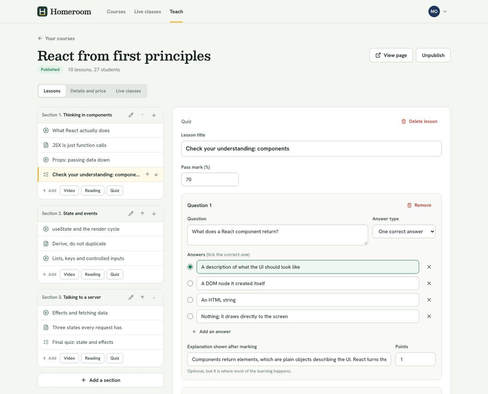

# Homeroom

An online school: courses, video lessons, live classes, quizzes, certificates and instructor earnings.

Built with the MERN stack, WebRTC, FFmpeg, BullMQ, AWS S3 + CloudFront and Redux Toolkit.



## Quick start

```bash
npm install
npm run dev
```

Open http://localhost:5173. Needs Node.js 20+ and nothing else: the first start creates `server/.env`, starts an
embedded database if no MongoDB is running, and loads demo content (12 courses with real HLS video, quizzes,
sales history and a live class timetable).

Demo accounts, password `homeroom123` for all (the sign-in page has one-click buttons):

| Role | Email |
| --- | --- |
| Student | `sam@homeroom.test` |
| Instructor | `maya@homeroom.test` |
| Admin | `admin@homeroom.test` |

**Going live** (MongoDB Atlas, Redis, S3 + CloudFront, Stripe, TURN, deployment): follow [`SETUP_GUIDE.md`](SETUP_GUIDE.md) step by step.

## What it does

| Brief | Where it lives |
| --- | --- |
| 1. Roles and schema | Students, instructors and admins with role-guarded routes. Mongoose models for users, courses (with sections), lessons, enrollments, quiz attempts, orders, live classes and certificates. `server/src/models` |
| 2. Course creation and video upload | Course editor with sections, video, reading and quiz lessons, reordering, publish checklist. Uploads are queued in **BullMQ**; a worker runs **FFmpeg** to produce adaptive HLS (360p, 720p, 1080p, never upscaled) and a poster, with live progress in the editor. `server/src/services/transcoder.js`, `server/src/jobs/transcodeJob.js` |
| 3. Delivery through CloudFront | Media goes to a private S3 bucket and is served from CloudFront. Locally the same code serves it from disk. `server/src/services/storage.js` |
| 4. Quizzes and progress | Single, multiple and true/false questions, auto-graded on the server, explanations after marking, unlimited retakes. Video resumes where you stopped and completes at 90% watched. Per-course progress. `server/src/services/grading.js`, `server/src/routes/learn.js` |
| 5. Live classes with chat | WebRTC mesh with camera, microphone, screen share, raise hand, host mute-all, persistent chat, a waiting room, and a public timetable. Signalling over Socket.IO. `server/src/realtime/rooms.js`, `client/src/hooks/useLiveRoom.js` |
| 6. PDF certificates | Issued automatically when every lesson is complete. Generated with PDFKit, with a public verification page. `server/src/services/certificatePdf.js` |
| 7. Revenue dashboard and payments | Stripe Checkout in test mode (with webhook), or a built-in test gateway when no Stripe key is set. Every sale is split into platform fee and instructor earnings; the dashboard charts earnings by day, by course and by sale. `server/src/routes/payments.js`, `server/src/routes/instructor.js` |

Beyond the brief: an admin area (totals, people, course moderation, video pipeline state), free previews,
zero-install local mode, a `doctor` command that checks every external service, optimistic UI updates,
route-level code splitting, and a keyboard-accessible interface that works down to phone width.

| | |
| --- | --- |
|  |  |
|  |  |

## Commands

| Command | Purpose |
| --- | --- |
| `npm run dev` | API (port 4000) and web app (port 5173) with reload |
| `npm run build` / `npm start` | Production: one server on port 4000 serves API and app |
| `npm test` | 45 API and unit tests against a real database and real FFmpeg |
| `npm run doctor` | Checks MongoDB, Redis, FFmpeg, S3, CloudFront, Stripe and TURN |
| `npm run seed:reset` | Wipe and reload the demo content |
| `npm run worker` | Standalone video worker |
| `npm run create-admin -- email password "Name"` | Create an admin |
| `python3 scripts/e2e_smoke.py` | Optional browser test, including a two-browser WebRTC class (needs Playwright) |

## Project layout

```
homeroom/
├── SETUP_GUIDE.md            step-by-step: run locally, then go live
├── docker-compose.yml        MongoDB + Redis for local development
├── Dockerfile                single image: API + built web app + FFmpeg
├── docs/                     architecture, API reference, test results
├── scripts/                  setup.mjs, e2e_smoke.py
├── server/                   Express API, Socket.IO, BullMQ worker
│   ├── .env.example          every setting, with placeholders
│   ├── src/
│   │   ├── index.js          API entry      worker.js  worker entry      doctor.js  health checks
│   │   ├── config.js         reads .env; placeholders count as "not set"
│   │   ├── models/           Mongoose schemas
│   │   ├── routes/           auth, courses, manage, learn, payments, instructor, live, certificates, admin
│   │   ├── services/         storage, transcoder, queue, payments, progress, grading, certificatePdf
│   │   ├── jobs/             transcodeJob.js (the BullMQ processor)
│   │   ├── realtime/         rooms.js (WebRTC signalling and chat)
│   │   └── seed/             demo content
│   └── tests/                vitest + supertest
└── client/                   React 18 + Vite + Redux Toolkit + Tailwind
    └── src/
        ├── store/            auth and ui slices, RTK Query API layer
        ├── pages/            catalog, course, player, checkout, live room, instructor, admin
        ├── components/       video player, quiz, timetable, covers, charts
        └── hooks/            useLiveRoom (WebRTC), useEnroll
```

## Documentation

- [`SETUP_GUIDE.md`](SETUP_GUIDE.md): local run and production setup, with every environment variable
- [`docs/ARCHITECTURE.md`](docs/ARCHITECTURE.md): diagrams, data model, design decisions, limits
- [`docs/API.md`](docs/API.md): REST endpoints and Socket.IO events
- [`docs/TEST_RESULTS.md`](docs/TEST_RESULTS.md): test output and performance numbers
- [`docs/PRESENTATION_OUTLINE.md`](docs/PRESENTATION_OUTLINE.md): a 10-minute talk track

## Known limits

- Live classes use a peer-to-peer mesh, comfortable to about 8 cameras. Larger classes need an SFU such as LiveKit (see the architecture notes).
- Live room state is in memory, so run one API instance (or add the Socket.IO Redis adapter).
- Instructor earnings are recorded and reported; paying them out to bank accounts (Stripe Connect) is not implemented.
- CloudFront URLs are unguessable but not signed. Signed cookies are the next step for paid content.
