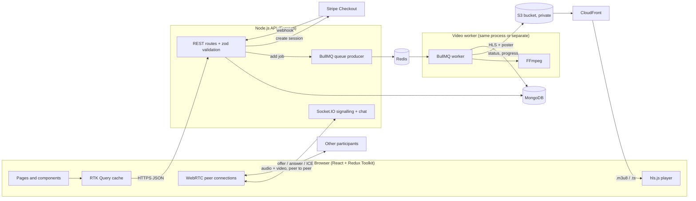
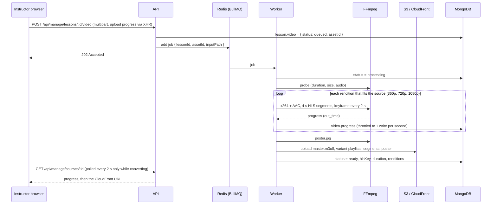
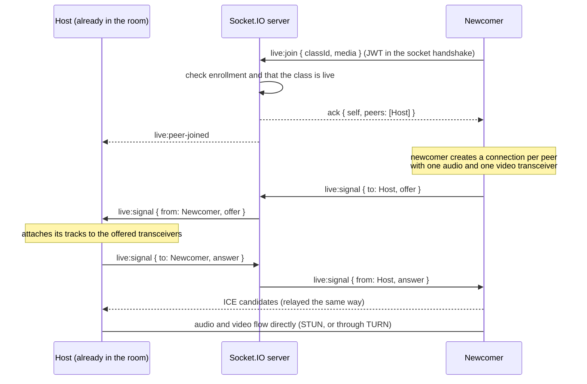
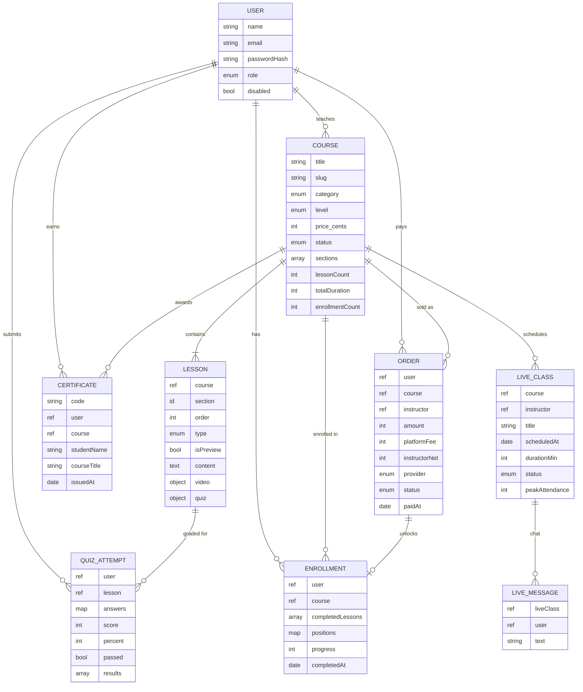

# Architecture

## System overview

One Node process serves the REST API, Socket.IO, and (in production) the built React app. The video worker runs inside
that process by default and can be moved to its own machine with `RUN_WORKER_IN_API=false` and `npm run worker`.

Every external dependency sits behind a small driver so the project runs on a laptop with no accounts:

| Concern | Production driver | Local fallback | Chosen by |
| --- | --- | --- | --- |
| Database | MongoDB (Atlas) | Embedded MongoDB, data in `server/.data` | `MONGO_URI`, `MONGO_MEMORY_FALLBACK` |
| Job queue | BullMQ on Redis | In-process queue running the same processor | `QUEUE_DRIVER` |
| Media storage | S3 + CloudFront | Local disk served from `/media` | `STORAGE_DRIVER` |
| Payments | Stripe Checkout (test keys) | Built-in test gateway | `STRIPE_SECRET_KEY` |
| NAT traversal | STUN + TURN | STUN only | `TURN_URL` |

## Video pipeline

Decisions:

- **The upload request returns immediately.** Transcoding a long video takes minutes; holding an HTTP request open that long is fragile. The lesson document is the source of truth for status, so any client can show progress.
- **One FFmpeg run per rendition**, then a hand-written master playlist. It is slightly slower than a single `var_stream_map` command but works the same for sources with or without audio and makes per-rendition progress exact.
- **No upscaling.** `pickRenditions` keeps only ladder steps at or below the source height.
- **Jobs are idempotent.** Each upload gets a fresh `assetId`; the job checks the lesson still points at that asset before writing, so a replaced or deleted lesson cannot be overwritten by a late job. BullMQ retries a failed job once with exponential backoff.
- **Keys, not URLs, are stored.** `urlFor(key)` builds a CloudFront or local URL at read time, so the delivery domain can change without a migration.

## Live classes

- **Topology: mesh.** Each participant connects to every other participant. No media server to run, which fits the brief and a small class. Cost grows with the square of the class size.
- **Who offers:** always the participant who joined later. That removes offer collisions without the full "perfect negotiation" dance.
- **No renegotiation for camera or screen share.** Both transceivers exist from the first offer; toggling the camera or sharing a screen is `RTCRtpSender.replaceTrack()`.
- **The server never sees media.** It authenticates sockets, checks room access, relays signalling, and broadcasts presence (`live:peer-state`), chat and host actions. Chat is saved so it remains readable after the class.
- **Waiting room.** Students who arrive early poll the class every 5 seconds and can join the moment the host starts it.

### Scaling live classes

| Need | Change |
| --- | --- |
| More than about 8 cameras | Replace the mesh with an SFU. LiveKit is the natural choice: keep `routes/live.js` for scheduling and access, issue LiveKit tokens from `GET /api/live/:id`, and swap `useLiveRoom` for the LiveKit client. |
| More than one API instance | Add `@socket.io/redis-adapter` and move the `rooms` map in `realtime/rooms.js` to Redis. |
| Strict networks | Configure TURN (`TURN_URL`). |

## Data model

Notes:

- **Sections are embedded in the course; lessons are their own collection.** Sections are few and always read with the course. Lessons are larger (article text, quiz questions, video state), are updated often by the worker, and are loaded one at a time by the player.
- **`lesson.video`** holds the pipeline state: `status` (none, queued, processing, ready, failed), `progress`, `assetId`, `hlsKey`, `posterKey`, `duration`, `renditions`, `error`.
- **`lesson.quiz`** embeds questions with `options`, `correct` (indexes) and `explanation`. The learner-facing serializer strips `correct` and `explanation`; grading happens only on the server.
- **Money is stored in minor units** (cents) as integers. The split is fixed on the order at purchase time, so changing `PLATFORM_FEE_PERCENT` later does not rewrite history.
- **Certificates snapshot** the student name, course title and instructor, so a certificate never changes after it is issued. `(user, course)` is unique.
- **Denormalised counters** on the course (`lessonCount`, `totalDuration`, `enrollmentCount`) keep the catalog query to a single indexed find; `recalcCourse` refreshes them after any change.

## Frontend

- **Redux Toolkit**: two small slices (`auth` with the persisted session, `ui` with toasts) and one **RTK Query** API definition for all server state. Tags drive refetching; nothing calls `fetch` from a component.
- **Feels fast because**: catalog pages are cached and prefetched on hover; reordering lessons and ticking a lesson complete update optimistically and roll back on failure; polling runs only while something is actually changing (a converting video, a class about to start); everything past the catalog is code-split, and hls.js (the largest dependency) loads only when a video is shown.
- **Design**: a classroom vocabulary. Chalkboard green for the surfaces where attention goes (timetable, player chrome, live room), pencil yellow for the one primary action and for progress, red pen for wrong answers. Courses without an image get a generated cloth-bound "textbook" cover per subject. Type is Besley (a Clarendon, the face of school textbooks) for headings and Hanken Grotesk for interface text, both self-hosted.
- **Accessibility**: semantic landmarks, labelled controls, visible focus, `aria-live` for results and toasts, reduced-motion respected, layouts tested at 390 px.

## Security

- Passwords hashed with bcrypt; JWT bearer tokens; the user is reloaded on every request so a disabled account or changed role takes effect immediately.
- Role checks on every route (`requireRole`), plus ownership checks (`loadManagedCourse`) so instructors can only touch their own courses.
- All input validated with zod at the route boundary; one error handler shapes every failure.
- Lesson content, playback URLs and quiz answers are only returned to enrolled students, the course owner or admins (previews excepted).
- Helmet with a content security policy; rate limiting on sign-in and registration; upload type and size limits; lesson Markdown is rendered to React elements, never injected as HTML.
- Stripe webhooks are verified with the signing secret; order fulfilment is idempotent.
- Media object names contain a random 16-character asset id. Next step for paid content: CloudFront signed cookies.
