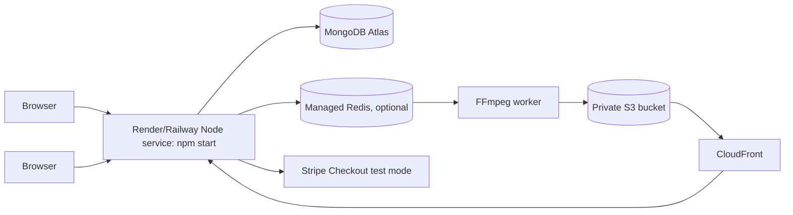

# Deployment plan

## Current status

**No deployment exists.** No Vercel, Render, Railway, Fly.io or Netlify project is configured, and no public URL has been verified. The repository has no GitHub remote, so nothing has been uploaded.

Do not claim the application is live until `/api/health` and the SPA are verified through the public URL.

## Recommended architecture for this submission

Use **one Node host** (Render Web Service, Railway or Fly.io) that runs `npm start`. This serves the built React app, REST API and Socket.IO from one HTTPS origin. It avoids CORS, cookie/token and WebSocket split-origin issues, and matches the documented in-memory live-class room state (one instance).



### Why not Vercel for this submission

Vercel is suitable only for `client/dist` as a static site with an SPA fallback. Splitting origins requires `VITE_API_URL` at build time, `CLIENT_URL`/`PUBLIC_URL` alignment, CORS and careful WebSocket proxying. It is supported by `client/src/lib/format.js` and `SETUP_GUIDE.md` Option 3, but it adds failure modes. Use it only if a platform requirement demands a separate frontend.

## Fastest reliable Node-host deployment

Platform example: Render.

| Setting | Value |
| --- | --- |
| Repository | Public GitHub repository (after approval) |
| Root directory | project root |
| Runtime | Node 20+ |
| Build command | `npm install && npm run build` |
| Start command | `npm start` |
| Health check | `/api/health` |
| Instances | **1** — live rooms are in memory |
| WebSockets | Must be enabled |

The service must be HTTPS; browsers require it for camera/microphone access outside localhost.

## Required environment variables

Set these on the hosting platform, never in committed files:

| Variable | Purpose |
| --- | --- |
| `NODE_ENV=production` | Disables dev fallbacks and demo auto-seed |
| `PORT` | Platform-provided; do not hard-code |
| `CLIENT_URL` | Final HTTPS app URL |
| `PUBLIC_URL` | Same as `CLIENT_URL` for single-host deployment |
| `JWT_SECRET` | Long random value; generate with `node -e "console.log(require('crypto').randomBytes(48).toString('hex'))"` |
| `JWT_EXPIRES_IN` | e.g. `7d` |
| `MONGO_URI` | MongoDB Atlas connection string including database name |
| `MONGO_MEMORY_FALLBACK=false` | Required in production |
| `AUTO_SEED=false` | Required in production |
| `REDIS_URL` | Managed Redis URL; required for BullMQ |
| `QUEUE_DRIVER=bullmq` | Production queue |
| `RUN_WORKER_IN_API=true` | Simplest single-service worker |
| `TRANSCODE_CONCURRENCY` | e.g. `1` |
| `FFMPEG_PATH` | Usually unnecessary; bundled `ffmpeg-static` is used |
| `FFMPEG_PRESET` | `veryfast` |
| `MAX_UPLOAD_MB` | e.g. `1024` |
| `STORAGE_DRIVER=s3` | Do not use local disk in production |
| `AWS_REGION`, `AWS_ACCESS_KEY_ID`, `AWS_SECRET_ACCESS_KEY` | S3 credentials or instance role |
| `S3_BUCKET` | Private bucket |
| `CLOUDFRONT_DOMAIN` | Distribution domain without `https://` |
| `STRIPE_SECRET_KEY` | Test-mode key `sk_test_...`; no live keys |
| `STRIPE_WEBHOOK_SECRET` | `whsec_...` from the webhook endpoint |
| `PLATFORM_FEE_PERCENT=20` | Revenue split |
| `CURRENCY=usd` | Currency code |
| `STUN_URLS` | Default Google STUN is acceptable for many networks |
| `TURN_URL`, `TURN_USERNAME`, `TURN_CREDENTIAL` | Required for strict networks; configure if available |

Follow [`SETUP_GUIDE.md`](SETUP_GUIDE.md) Part B for exact AWS/IAM/CloudFront and Stripe setup steps.

## First production admin

Production starts empty (`AUTO_SEED=false`). Create an admin from a shell with the production environment variables:

```bash
npm run create-admin -- you@example.com "a-strong-password" "Your Name"
```

Do **not** load the public demo passwords into production without changing them.

## Vercel + Render split option

Only if required:

1. Deploy the API on Render using the Node-host settings above.
2. Build with `VITE_API_URL=https://api.example.com` set in the Vercel project, then deploy `client/dist`.
3. Configure SPA fallback to `index.html`.
4. On the API set `CLIENT_URL=https://frontend.example.com` and `PUBLIC_URL=https://api.example.com`.
5. Point the Stripe webhook at the API origin.

## External inputs required from the owner

No deployment will be attempted without approval and these inputs:

- GitHub repository name/URL and approval to make it public and push.
- Hosting account/access for Render or another Node host.
- MongoDB Atlas URI and database user credentials.
- Managed Redis URL if BullMQ is required.
- AWS credentials, private S3 bucket and CloudFront domain.
- Stripe **test-mode** secret key and webhook signing secret.
- TURN URL, username and credential if strict-network live classes are required.
- Final public domain(s) for `CLIENT_URL` and `PUBLIC_URL`.

Configure secrets directly on the hosting platform. Do not paste them into repository files or chat.

## Post-deployment acceptance check

1. `GET /api/health` returns `ok: true`, `env: production`, `database: mongodb`, `queue: bullmq`, `storage: s3`, `payments: stripe`, `ffmpeg: true`; `turn: true` only if TURN is configured.
2. Register student/instructor, create a course, upload an MP4, confirm HLS requests go to CloudFront.
3. Buy a course with Stripe test card `4242 4242 4242 4242`; confirm unlock via page and webhook.
4. Finish lessons, pass quiz, download and verify certificate.
5. Two-browser live class with camera, microphone, chat and end control.
6. Instructor dashboard shows the sale and 80/20 split.

Until these pass on public URLs, the deployment status remains **NOT DEPLOYED**.
