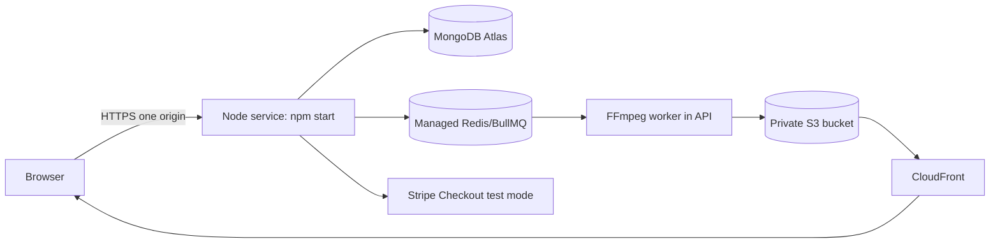

# Production deployment

## Status

**NOT DEPLOYED.** No public frontend or backend URL exists. The GitHub repository is public at <https://github.com/sanskarp10/homeroom-lms>, but hosting credentials for a Node-capable backend, MongoDB, Redis and object storage have not been provided.

The Vercel CLI is authenticated, but Vercel alone cannot host this application: Socket.IO, long-running FFmpeg jobs, local upload buffering and the in-memory live-room map require a long-running Node process. Deploying only `client/dist` would produce a public shell whose API calls fail, so no partial deployment was created.

## Selected architecture

Use one long-running Node host (Render/Railway/Fly-style) serving:

- built React SPA from `client/dist`;
- REST API under `/api`;
- Socket.IO under `/socket.io`;
- media from S3/CloudFront (or a persistent volume only as a documented fallback);
- FFmpeg worker inside the API process initially.



This is the only architecture compatible with the current in-memory live-class room map without code changes. Run **one instance**.

## Build and start

From the repository root:

```bash
npm install && npm run build
npm start
```

Health check: `/api/health`.

## Production startup guards

`server/src/config.js` now fails startup in production when local/test fallbacks would be unsafe:

- missing `JWT_SECRET`;
- `MONGO_MEMORY_FALLBACK=true`;
- `AUTO_SEED=true`;
- `QUEUE_DRIVER=inline`;
- local media storage or incomplete S3/CloudFront settings;
- missing `STRIPE_SECRET_KEY` or a non-test key;
- missing `STRIPE_WEBHOOK_SECRET`;
- localhost or non-HTTPS `CLIENT_URL` / `PUBLIC_URL`.

These guards are covered by unit tests. They do not affect development or test mode.

## Deployment steps when credentials are available

1. Create a managed MongoDB database and user; set `MONGO_URI`.
2. Create managed Redis; set `REDIS_URL` and `QUEUE_DRIVER=bullmq`.
3. Create a private S3 bucket + CloudFront OAC distribution; set S3 variables and `CLOUDFRONT_DOMAIN`.
4. Create Stripe **test-mode** keys and a webhook endpoint at `/api/payments/webhook`.
5. Configure all variables in [`PRODUCTION_ENV_CHECKLIST.md`](PRODUCTION_ENV_CHECKLIST.md) on the host.
6. Create the Node service from the GitHub repo with the commands above, WebSockets enabled and one instance.
7. Set `CLIENT_URL` and `PUBLIC_URL` to the final HTTPS URL.
8. Run `npm run create-admin -- email password "Name"` with a secure admin account.
9. Verify `/api/health` and then run [`PRODUCTION_QA.md`](PRODUCTION_QA.md) against the public URL.
10. Do not enable paid media or real-money payments without further security work.

## Optional Vercel split

`vercel.json` is included for a static Vite deployment with SPA fallback. It is not used by the recommended single-host setup. If split hosting is required:

- set `VITE_API_URL` to the API origin **before** building on Vercel;
- set API `CLIENT_URL` to the Vercel origin;
- keep one API instance and WebSocket support.

## Exact owner action required

Provide or configure (do not paste secrets into chat):

- Node host account for Render/Railway/Fly or equivalent;
- MongoDB Atlas URI and database user;
- managed Redis URL;
- AWS credentials, bucket and CloudFront domain;
- Stripe test-mode key and webhook secret;
- optional TURN URL/username/credential;
- final HTTPS domain.

No deployment is claimed until those steps are completed and independently verified through public URLs.
